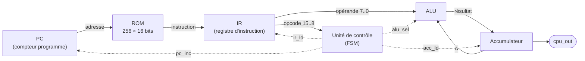

# CPU 8 bits en VHDL

Un petit processeur à accumulateur, écrit en VHDL et simulé sous ModelSim.
Données sur **8 bits**, instructions sur **16 bits**, exécution en **3 cycles** par instruction (FETCH → DECODE → EXECUTE).

Le projet est volontairement simple et lisible : l'idée est de comprendre comment fonctionne un processeur, et de pouvoir facilement y ajouter des instructions.

---

## Caractéristiques

| Élément | Valeur |
|---|---|
| Largeur des données | 8 bits |
| Largeur des instructions | 16 bits (8 bits d'opcode + 8 bits d'opérande) |
| Compteur de programme (PC) | 8 bits, soit 256 instructions maximum |
| ROM programme | 256 × 16 bits |
| Registre de travail | 1 accumulateur 8 bits |
| Reset | asynchrone, actif à l'état bas (`rstb`) |
| Arithmétique | non signée, modulo 256 |

---

## Architecture



### Composants

| Fichier | Entité | Rôle |
|---|---|---|
| `top.vhd` | `CPU` | assemble tous les composants (architecture structurelle) |
| `u_pc.vhd` | `PC` | compteur de programme : incrément ou chargement d'une adresse |
| `u_rom.vhd` | `ROM` | mémoire programme (le programme est écrit en dur dans le fichier) |
| `u_ir.vhd` | `IR` | registre d'instruction : mémorise l'instruction en cours |
| `u_control_unit.vhd` | `control_unit` | machine à états : séquence FETCH / DECODE / EXECUTE et décodage des opcodes |
| `u_alu.vhd` | `ALU` | unité arithmétique et logique (combinatoire) |
| `u_acc.vhd` | `Accumulateur` | registre qui contient le résultat courant |
| `u_ram.vhd` | `RAM` | mémoire de données (pas encore utilisée, voir *Feuille de route*) |
| `tb_top.vhd` | `testbench` | génère l'horloge et le reset, instancie le CPU |

### Cycle d'exécution

| État | Ce qui se passe |
|---|---|
| **FETCH** | la ROM lit l'instruction à l'adresse du PC, l'IR la mémorise (`ir_ld = 1`) |
| **DECODE** | l'unité de contrôle décode l'opcode et sélectionne l'opération de l'ALU ; le PC avance (`pc_inc = 1`) |
| **EXECUTE** | l'accumulateur charge le résultat de l'ALU (`acc_ld = 1`), sauf pour un NOP |

---

## Jeu d'instructions

### Format

```
 15            8 7             0
┌───────────────┬───────────────┐
│    opcode     │   opérande    │
│    8 bits     │    8 bits     │
└───────────────┴───────────────┘
```

Astuce : en hexadécimal, les 2 premiers chiffres sont l'opcode et les 2 derniers l'opérande.
Par exemple, `x"01C8"` = `ADD 200`.

### Instructions disponibles

| Mnémonique | Opcode | `alu_sel` | Effet |
|---|---|---|---|
| `NOP` | `0x00` | `000` | ne fait rien, l'accumulateur est conservé |
| `ADD n` | `0x01` | `001` | ACC ← ACC + n |
| `SUB n` | `0x02` | `010` | ACC ← ACC − n |
| `LSL n` | `0x03` | `011` | ACC ← ACC décalé de n bits à gauche |
| `LSR n` | `0x04` | `100` | ACC ← ACC décalé de n bits à droite (logique, des 0 entrent à gauche) |

Les calculs se font sur 8 bits non signés : un résultat qui dépasse 255 est pris **modulo 256**.
Par exemple, `200 + 100` donne `44`.

---

## Lancer la simulation

### Prérequis

- ModelSim (testé avec *ModelSim – Intel FPGA Edition 10.5b*)
- VHDL-93

### Commande

Dans la console ModelSim, depuis le dossier du projet :

```tcl
do run_v3.tcl
```

Le script compile tous les fichiers dans l'ordre, lance la simulation du testbench pendant 500 ns et affiche les chronogrammes.
S'il trouve un fichier `wave.do`, il l'utilise pour choisir les signaux à afficher ; sinon, il ajoute tous les signaux du design.

### Programme de démonstration

La ROM contient ce petit programme :

| Adresse | Instruction | Hexa | `cpu_out` attendu |
|---|---|---|---|
| 0 | `NOP` | `0x0000` | 0 |
| 1 | `ADD 14` | `0x010E` | 14 |
| 2 | `LSR 1` | `0x0401` | 7 |
| 3 | `LSL 1` | `0x0301` | 14 |

<!-- Ajoute ici une capture du chronogramme, par exemple :  -->

---

## Ajouter une instruction

Exemple : ajouter un `AND n` avec l'opcode `0x05`.

1. **Unité de contrôle** (`u_control_unit.vhd`)
   - déclarer la constante : `constant AND_OP : std_logic_vector(7 downto 0) := "00000101";`
   - ajouter le cas dans le décodage : `when AND_OP => alu_sel <= "101";`
2. **ALU** (`u_alu.vhd`)
   - ajouter le cas correspondant : `when "101" => alu_out <= alu_in_A and alu_in_B;`
3. **ROM** (`u_rom.vhd`)
   - écrire un petit programme de test, par exemple `x"010F"` (ADD 15) puis `x"0506"` (AND 6), résultat attendu : 6.
4. **Simuler** et vérifier le résultat dans les chronogrammes.

Attention : l'opcode doit faire **exactement 8 bits**. En VHDL, comparer deux vecteurs de tailles différentes renvoie toujours *faux*, sans erreur : l'instruction serait alors traitée comme un NOP.

---

## Feuille de route

- [ ] RAM synchrone en 8 bits, branchée sur l'accumulateur
- [ ] Instructions `LOAD adr` et `STORE adr`
- [ ] Instruction de saut `JMP adr` (le PC sait déjà charger une adresse via `pc_ld`)
- [ ] Flag de retenue / dépassement dans l'ALU, puis sauts conditionnels
- [ ] Package commun (`cpu_pkg.vhd`) pour les largeurs de bus et les opcodes
- [ ] Testbench auto-vérifiant (avec `assert`)
- [ ] Coprocesseur relié par une RAM partagée

Les contributions sont les bienvenues : n'hésite pas à ouvrir une *issue* ou une *pull request*.

---

## Licence

Ce projet est distribué sous licence MIT. Voir le fichier [`LICENSE`](LICENSE).

## Auteur

[bilelbensaid](https://github.com/bilelbensaid)
